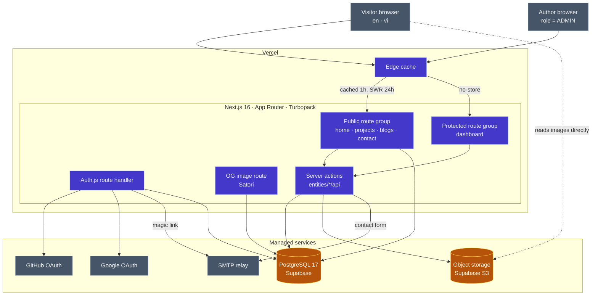
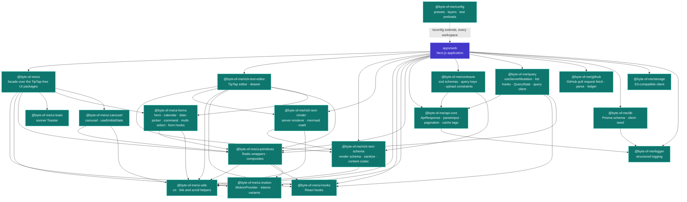
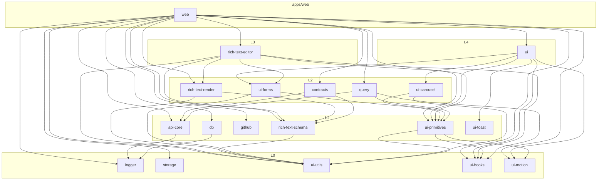
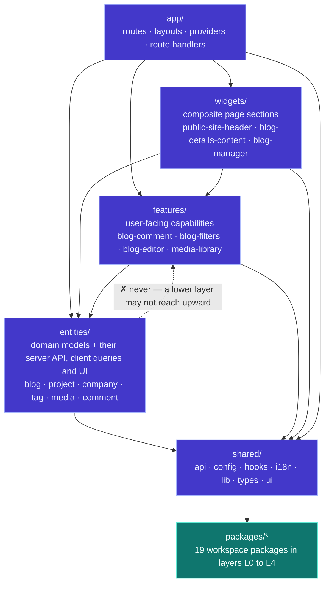
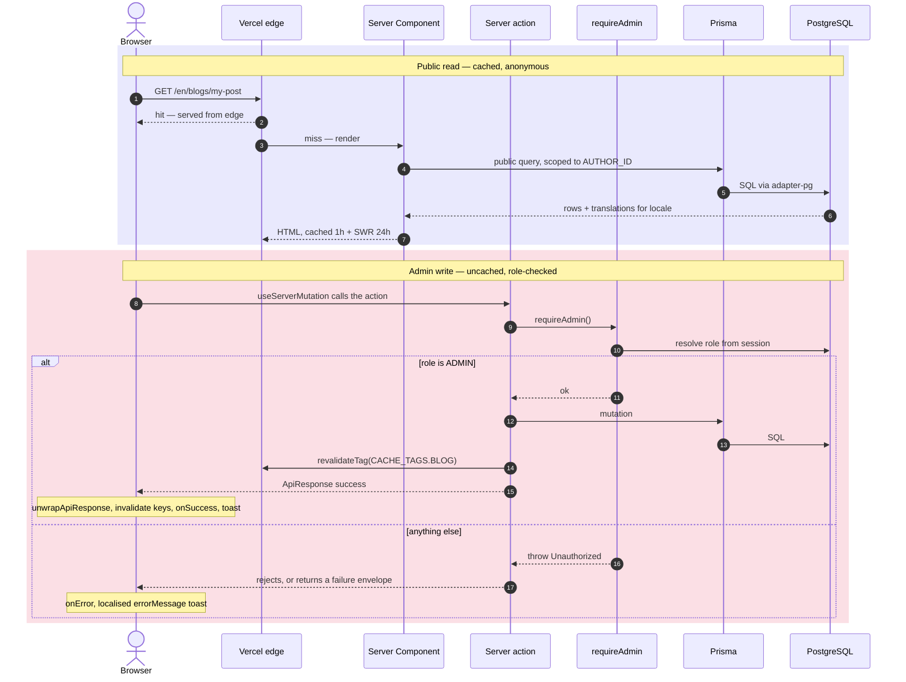
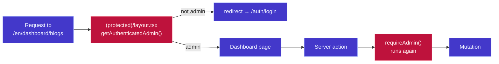
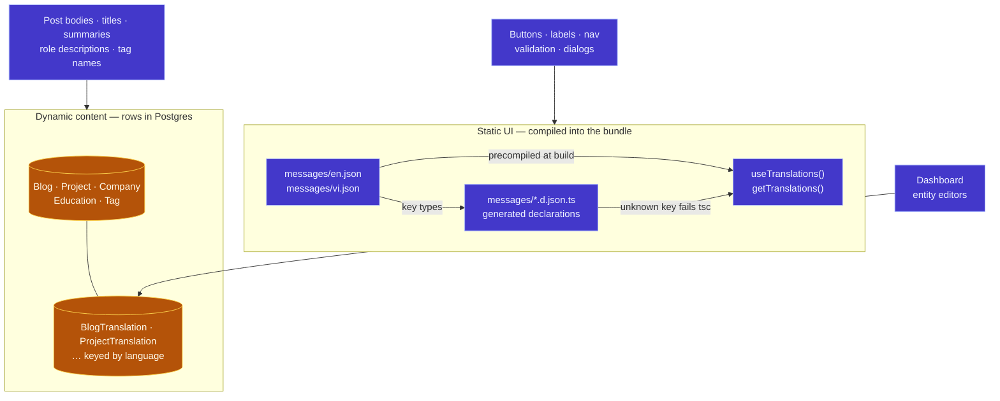
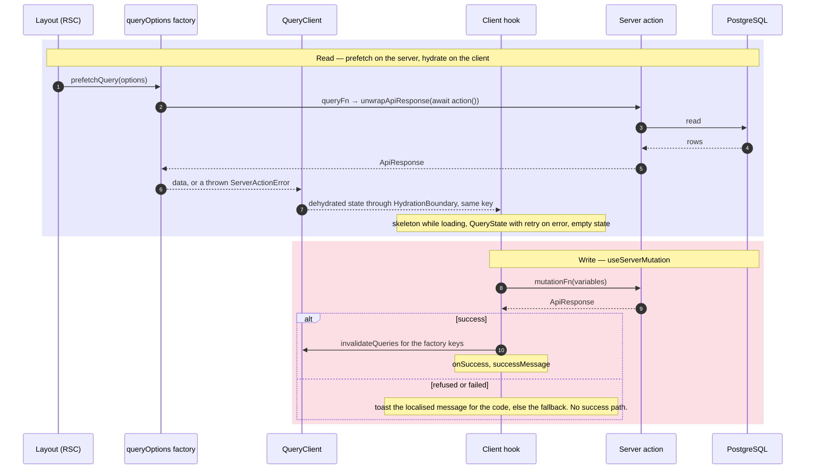
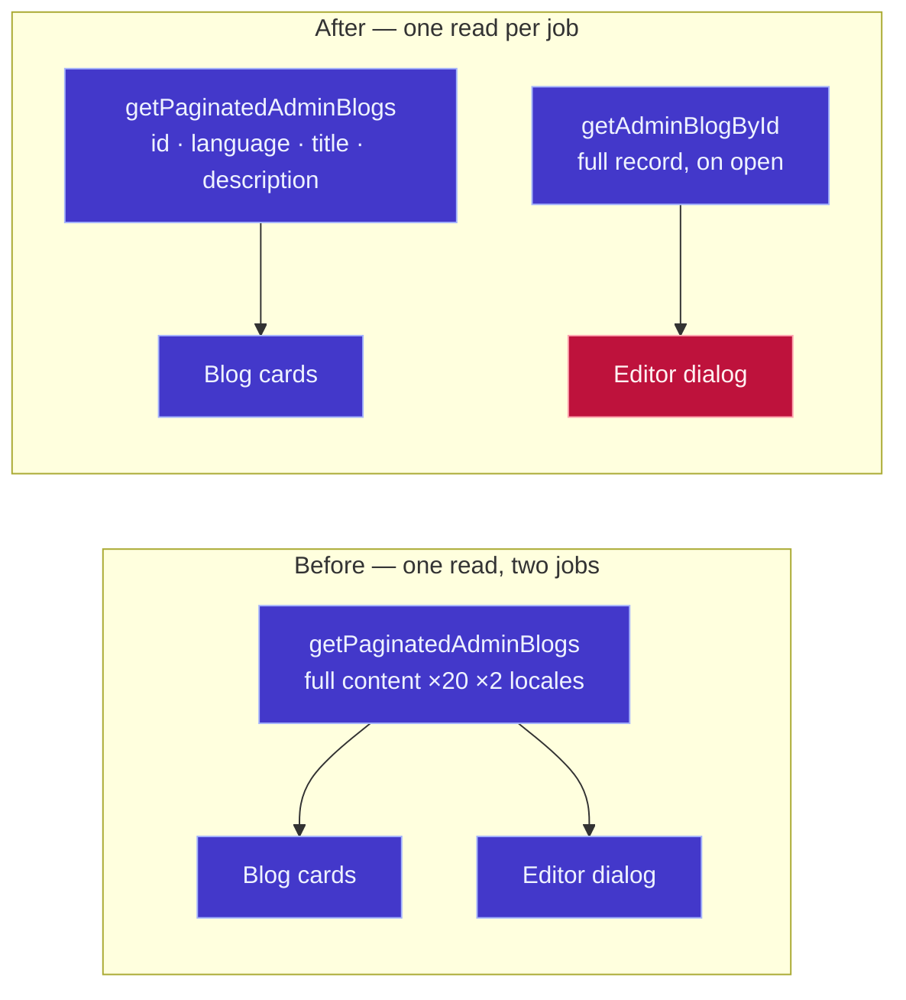

# Architecture

How **Byte of Me** fits together, from the outside in. Five diagrams, each answering one question:

1. [System context](#1-system-context) — what runs where, and what we don't own
2. [Monorepo & package graph](#2-monorepo--package-graph) — which workspace depends on which
3. [Feature-Sliced Design](#3-feature-sliced-design-layers) — how `apps/web` is layered
4. [Request & trust flow](#4-request--trust-flow) — how a read differs from an admin write
5. [Two-layer i18n](#5-two-layer-internationalization) — where each kind of string lives

Then: [caching & invalidation](#caching--invalidation) and [where to change what](#where-to-change-what).

---

## Legend

Colour encodes **ownership**, not category — it answers "if this breaks, whose problem is it?"

| | Meaning |
| --- | --- |
| 🟦 **Indigo** | Application code we ship in the Next.js runtime |
| 🟩 **Teal** | Workspace packages (`packages/*`), consumed as TypeScript source |
| 🟧 **Amber** | Persistent state — Postgres tables, the storage bucket |
| 🟥 **Rose** | Trust boundary: something checks a role here |
| ⬛ **Slate** | Outside our deploy — browsers, managed services, OAuth providers |

Dashed borders mark a boundary we don't deploy across.

---

## 1. System context

**Notes**

- There is no `middleware.ts`. `/` redirects to `/en`; the locale is a route segment; unmatched paths fall through to a catch-all that calls `notFound()`.
- Cache policy is set per route group in `next.config.js` `headers()` — public gets `s-maxage=3600, stale-while-revalidate=86400`, anything under `dashboard` gets `no-store`.
- Uploads go **through** the server action (multipart → `PutObject`), so storage credentials never reach the browser. Reads bypass the app entirely: `next/image` is allowed to fetch from the Supabase host listed in `remotePatterns`.
- Prisma 7 talks to Postgres through `@prisma/adapter-pg` — a driver adapter, not a query-engine binary. That is why nothing here ships a native engine.

---

## 2. Monorepo & package graph

Solid arrows are runtime dependencies; dashed arrows are build-time only — `@byte-of-me/config` ships no application code: `tsconfig` presets that each workspace extends by relative path (`library.json` in 16 packages and `scripts/`, `nextjs.json` in `apps/web`, `node-library.json` in `storage` and `logger`, `base.json` in `db`; the dashed edge stands for all of them), `boundaries.json` (below), and the `bun test` preloads in `test/`.

Every package is consumed as **TypeScript source** via `transpilePackages`, so there is no build step before `bun run dev`. `next.config.js` derives that list from the root `workspaces` (every directory under `packages/`), so a new package is never added by hand. No package has a `build` script or a `dist/`; `turbo run build` builds only the web app. Turborepo's task cache still follows the package graph: `check-types`, `lint`, `test` and `build` depend on a script-less `transit` task, so editing a package's source re-runs that package's tasks and those of every package that depends on it (directly or not), and nothing else ([codebase/tooling-and-small-packages.md](codebase/tooling-and-small-packages.md), "Turbo graph").

`@byte-of-me/ui` is a facade: its `src/index.ts` re-exports the TipTap-free packages and it has no other export. The editor is `@byte-of-me/rich-text-editor` (layer 3, one root export), reached only through `LazyRichTextEditor`, and the facade never re-exports it: importing it from a public-site client component would drag all of TipTap into the visitor's bundle. The schema the editor and the server renderer share is `rich-text-schema`: its root is the TipTap schema (server-safe, no React, no `'use client'`, no mermaid), and `sanitizeHtml` and the rich-text content helpers are its `./sanitize` and `./rich-text-content` subpaths, so a client component that needs one never imports the root. The renderer is `rich-text-render` and has no root at all: `./rich-text` and `./rich-text-render` are server only (`generateHTML` and the schema, about 1 MB), `./rich-text-html` and `./mermaid-size` are client-safe, and `./mermaid-blocks` and `./math-renderer` are client leaves, so each importer names the half it needs. The class-name helper, the hooks, the motion tokens, the Radix wrappers, the toaster, the form controls and the carousel are separate packages (`ui-utils`, `ui-hooks`, `ui-motion`, `ui-primitives`, `ui-toast`, `ui-forms`, `ui-carousel`); `apps/web/src/shared/lib/utils.ts` takes `cn` from `ui-utils` because the `ui` barrel breaks `/api/og`, and the `ui` root re-exports hooks, motion, primitives, toast, forms and carousel, so the root-barrel imports in `apps/web` did not move.

### Package layers

A package imports only packages in a lower layer, and `apps/web` sits above them all. The layers are declared in `packages/config/boundaries.json`.

`api-core` is layer 1, not 0, because `parseInput` logs through `logger` (layer 0). Its root is client-safe (no `logger`, no `node:*`) and its `./server` subpath holds `parseInput` and `getClientIp`. It is on the `noReact` list.

`contracts` (layer 2) holds the pure half of each entity: the zod schemas, the TanStack query-key factories, the upload constraints, the cache-tag maps and the image-compression config. It imports only `api-core`, the light `rich-text-schema` subpaths and zod, so every export is safe in a `'use client'` file, and it is on both the `noReact` and `dbTypesOnly` lists. The Prisma-derived types (`entities/*/model/types.ts`, the `admin-*-include.ts` files) stay in `apps/web`. A query key is a contract with the server prefetch: a key that drifts hydrates nothing and raises no error.

`query` (layer 2) holds the client-state code that needs TanStack Query and nothing from the app: `useServerMutation` (the one write path), `useInfiniteListQuery`, `useEditingRecord`, `useUrlSyncedSearch`, `QueryState`, the query client (`makeQueryClient`, `getQueryClient`) and `ADMIN_PAGE_SIZE` / `ADMIN_OPTIONS_LIMIT`. `react`, `@tanstack/react-query` and `sonner` are peers, so the app and the package share one instance of each. `useCrudManager` and `useEditorLabels` stay in `apps/web/src/shared/hooks/` because they read next-intl.

`github` (layer 1, on the `noReact` list, no dependency at all) is the pure GitHub pull request code: the merged-pull-request search, `groupByRepo` and the ledger helpers behind the open-source section and `/projects`, and the batched lookup and URL parser behind the featured works. Every fetch takes its token as an argument; the env read, the logger, the data cache and the database stay in the three files of `apps/web/src/entities/` that call it.

`bun run check-boundaries` (step 3 of `bun run check`) reads every source file with the TypeScript compiler API and prints `file:line  rule  message` per violation, exiting 1 on any. It runs in under a second and enforces:

| Rule | Id | Meaning |
| --- | --- | --- |
| 1 | `layers` | A package imports only lower layers; same-layer and upward imports, and so cycles, are violations. A package that exports code must be listed in `boundaries.json`. |
| 2 | `facade`, `no-app` | No package imports `@byte-of-me/ui` (the facade), `apps/`, or the `@/` alias. |
| 3 | `exports`, `deps` | A cross-package import goes through the target's `exports` map, and the importer lists the target in `dependencies` or `peerDependencies`. |
| 4 | `no-react` | Packages named in `noReact` never import `react` or `react-dom` and never carry `'use client'`. This list is explicit, not "all of L0", because the React hooks and motion packages are L0; `rich-text-schema` (L1) is on it, which is what keeps the server renderer's schema free of React. The list is `api-core`, `contracts`, `github`, `logger`, `rich-text-schema`, `storage` and `ui-utils`; `dbTypesOnly` is `contracts`. |
| 5 | `db-types` | Packages named in `dbTypesOnly`, and any `'use client'` file, import `@byte-of-me/db/types`, never the db root. |
| 6 | `fsd` | Inside `apps/web/src`, no `@/entities` root-barrel import and no import of a layer above the importing one (`shared` to `entities`, `entities` to `features`, and so on). |

Rule 7, that a heavy dependency belongs to exactly one package and `react`, `framer-motion`, `sonner` and `@tanstack/react-query` are peers, is review advice and is not checked.

`bun run new-package <name> --layer <n> [--dom] [--tests] [--css]` creates `packages/<name>` from the `library.json` preset, lists it in `boundaries.json` and adds it to `apps/web/package.json`; it then prints the manual steps.

---

## 3. Feature-Sliced Design layers

`apps/web/src` is layered. A layer may import from the layers **below** it, never above and never sideways across slices.

The dashed edge is the rule worth stating out loud: an `entity` never imports a `feature`. If an entity seems to need one, the logic belongs in the entity, or the feature needs to pass it in.

A slice that other slices import exposes an `index.ts` barrel, and cross-slice imports go through it rather than reaching into a file path. A slice nobody imports through one has none: `company`, `featured-work`, `open-source`, `social-link` and `workspace-settings` (entities), `features/auth` and `widgets/dashboard/dashboard-sidebar` are imported by file path.

Within `widgets/` and `features/`, slices are grouped by audience — `auth`, `dashboard`, `public` — which keeps the "never expose dashboard functionality to a public route" rule visible in the directory listing rather than buried in a guard.

---

## 4. Request & trust flow

Two paths through the same codebase. The difference is not the route — it's who checks the role.

A guard placed above the action's `try` makes the promise reject; a guard inside it returns a failure envelope. Both fail closed, and both reach the client as a failed mutation. A refused business rule is a third case: the action returns `{ success: false, errorMsg }` (and an `errorCode` when it names its reason), and the client throws `ServerActionError` from `unwrapApiResponse`. In every case the success path does not run.

**Two independent guards, on purpose:**

The layout guard protects the *view*. It does not protect the *action* — server actions are addressable endpoints, callable without ever rendering the page. So every admin action and admin query calls `requireAdmin()` itself. The route guard is convenience; the action guard is the security boundary.

Auth.js issues JWT sessions that expire after 7 days (re-issued daily while in use). The role is read from the database on sign-in and carried on the token; providers are email magic link, GitHub, and Google.

---

## 5. Two-layer internationalization

Two translation systems that must never be mixed.

The dividing line: **if a translator would need the running app to know what the string means, it's UI text** (next-intl). If it's something the author writes as content, it's a database translation. Never move content into locale JSON; never store UI strings in the database.

A third path used to exist — a `Translation` table whose rows were merged into the next-intl catalogue at request time — and it has been removed. It never worked (dot-path keys were never nested, and the query was unfiltered by locale), and it blurred the very line this section draws.

The client catalogue is scoped per route group rather than mounted once at the locale root: each group layout mounts `NextIntlClientProvider` with only the namespaces its **client** components read (see `src/shared/i18n/messages.ts`). Server components use `getTranslations` and never constrain those lists. Reads of `*Translation` rows are filtered to `[locale, 'en']` — see `getTranslationLanguages`.

Locales are `en` (default) and `vi`, declared once in `src/shared/i18n/routing.ts`.

---

## Client reads and writes

Every client read and write goes through TanStack Query. The one exception is a write that throws instead of returning an envelope (the image uploaders), which uses `useMutation` directly. A server prefetch and the client hook both call the same `queryOptions` factory (`entities/<slice>/query/<slice>-queries.ts`), built on the key factory in `@byte-of-me/contracts/<slice>`, so the key and the query function cannot drift apart. A mismatch raises no error: it falls through to a client fetch and leaves skeletons on screen.

## Caching & invalidation

Three layers, each invalidated differently:

| Layer | Scope | Invalidated by |
| --- | --- | --- |
| Vercel edge (`headers()`) | Public HTML, 1h + 24h SWR | Time, or a deploy |
| Next.js data cache | Tagged queries | `revalidateTag(CACHE_TAGS.X)` inside the mutating server action |
| TanStack Query | Every client read and write, dashboard and public lists (image uploads are the one `useMutation` that throws) | `useServerMutation` invalidates the factory keys after the envelope check |

`CACHE_TAGS` (`packages/api-core/src/constants.ts`) is the single list of tags — `blog`, `company`, `contact-message`, `education`, `featured-work`, `media`, `open-source`, `project`, `social-link`, `tag`, `tech-stack`, `user-profile`, `comment`, `workspace-settings`. A mutation that forgets its tag is the usual cause of "I saved it but the public page is stale."

`purgeEntireCache()` in `src/widgets/dashboard/dashboard-sidebar/lib/purge-entire-cache.ts` (the dashboard's Clear Cache button) is the blunt escape hatch — `revalidatePath('/', 'layout')`.

Blog view counts deliberately sit outside all of this: `trackBlogView` writes a `BlogStatisticLog` row guarded by a per-post cookie signed with `AUTH_SECRET`, and live stats are cached for 300 s under the BLOG tag.

---

## Where to change what

| I want to… | Start here |
| --- | --- |
| Add a page | `apps/web/src/app/[locale]/(public)/` + a widget in `widgets/public/` |
| Add a dashboard section | `app/[locale]/(protected)/dashboard/` + `widgets/dashboard/` + `features/dashboard/` |
| Change what a domain model can do | `entities/<model>/api/` — one file per operation, each starting with a guard |
| Add a UI string | `apps/web/messages/en.json` **and** `vi.json` (types regenerate on build; `i18n-parity.spec.ts` fails if you touch only one) |
| Add a dashboard editor | A **separate by-id read** for the form — never reuse the list row. See below |
| Add a translatable content field | `packages/db/prisma/schema.prisma` → the `*Translation` model → migration |
| Add a shared component | a Radix wrapper or plain element: `packages/ui-primitives/src/` + a line in its `src/index.ts`; a control that needs react-hook-form, cmdk or react-day-picker: `packages/ui-forms/src/`; one that needs embla: `packages/ui-carousel/src/`; a TipTap node both the editor and the server renderer draw: `packages/rich-text-schema/src/` (the editor's behaviour for it stays in `packages/rich-text-editor/src/`); a server-rendered piece of an article, or a client leaf that finishes one (mermaid, math): `packages/rich-text-render/src/` and a subpath in its `exports`; one that needs the editor: `packages/rich-text-editor/src/`; an app-only piece: `apps/web/src/shared/ui/` |
| Add a form schema, query key or upload constraint | `packages/contracts/src/<slice>/` (a `<slice>-schema.ts` or `query-keys.ts` plus a line in its `index.ts`); no `@/` alias, no `react`, no database import |
| Add a client read or write | `entities/<slice>/query/` (a `<slice>-queries.ts` factory and a `use-*.ts` hook); writes through `useServerMutation` (`packages/query/src/use-server-mutation.ts`) |
| Change cache behaviour | `next.config.js` `headers()` for edge, `CACHE_TAGS` for data |
| Change who can do something | `src/shared/lib/auth/session.ts` |

---

## List reads and edit reads are separate

A dashboard manager renders a list; clicking Edit opens a dialog. The tempting shortcut is
to hand the list row straight to the dialog as `initialData` — and blogs did exactly that,
which forced the list query to carry every post's full TipTap body (20 posts × 2 locales)
so the editor would have something to open.

That coupling is worse than the wasted bytes: narrowing the list query then empties the
editor, and the next Save writes that emptiness over a published post.

The dialog is a trust boundary of its own: it must not mount the form until the full record
has arrived. The guard is `Boolean(editing) && !fullRecord` — one condition covering
loading, fetch failure **and** idle, because any of the three leaves the form holding a
partial row.

`project`, `tag` and `company` still reuse their list rows. Their
translatable fields are short, so today it is only wasted bytes — but the failure mode is
identical the moment one of them grows.

---

*Diagrams render natively on GitHub. Edit this file rather than exporting images — the source of truth should diff.*
